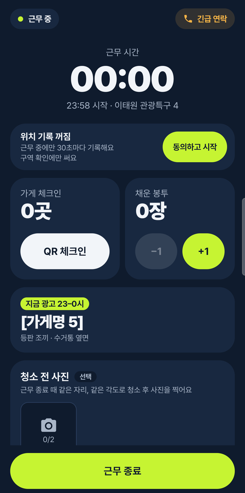
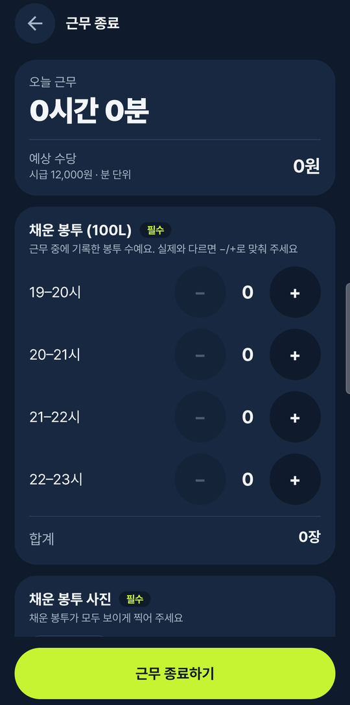
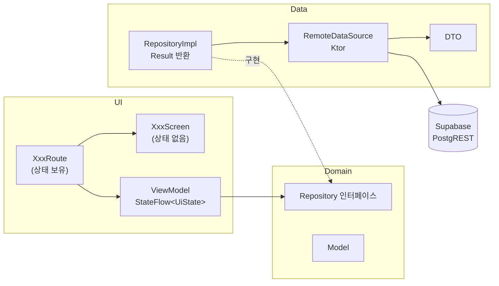

# Alley Glow (앨리 글로우)

상권 골목의 야간 청소 인력이 가게 광고를 단 조끼를 입고 거리를 청소하면서, 지나가는 사람들에게 가게를 안내하는 서비스입니다.
청소 인력의 인건비는 가게 광고비와 서울시의 수거량 보상으로 나눠 부담합니다.

> 2026 서울 야간경제 활성화 해커톤 출품을 준비하며 만든 개인 토이 프로젝트입니다. 대회에는 참가하지 않았고, 이태원 5개 가게 시범 운영을 가정해 만들었습니다.

## 내려받기

[Android APK 내려받기](https://github.com/koolunkle/alley-glow/releases/latest/download/alley-glow.apk) (Android 7.0 이상)

- 회원가입이 없어 운영자가 발급한 계정으로만 로그인할 수 있습니다. 공개 데모 계정은 없으니 화면은 아래 [주요 화면](#주요-화면) 스크린샷으로 확인해 주세요.
- Play 스토어 앱이 아니라서 설치할 때 '출처를 알 수 없는 앱' 허용이 필요합니다.
- 시민용 QR 랜딩은 설치 없이 웹으로 열립니다.

## 해결하려는 문제

서울시와 자치구는 야간 청결에 돈과 인력을 더 쓰고 있지만, 대응은 쓰레기통과 수거 횟수를 늘리는 데 머물러 있습니다.

- **쓰레기통 딜레마**: 서울 가로쓰레기통은 1995년 7,607대에서 2007년 3,707대로 줄었다가 다시 늘리고 있습니다. 하지만 "없으면 길거리 투기, 만들면 얌체 투기"라는 딜레마가 남아 있습니다. ([서울시](https://news.seoul.go.kr/env/archives/507323), [MBC 2025.2.10](https://imnews.imbc.com/replay/2025/nwdesk/article/6685269_36799.html))
- **야간 청결이 정책 과제로**: 서울형 야간경제 대책(2026.8)은 야간 유동 인구가 많은 지역에 청결기동대를 투입합니다. 보도 기준 150명입니다. ([내 손안에 서울 2026.8.20](https://mediahub.seoul.go.kr/archives/2019126), [뉴스핌 2026.8.20](https://www.newspim.com/news/view/20260820000601))
- **수거 횟수 늘리기**: 마포구는 홍대 레드로드의 수거를 주 5일 야간에서 주 7일 주야간으로 늘렸습니다. ([헤럴드경제 미주판 2026.4.21](https://www.heraldk.com/article/2026042113400052188))
- **처리비 증가**: 2026년부터 수도권 생활폐기물 직매립이 금지되어 자치구의 처리 비용 부담이 커지고 있습니다. ([서울시 2025.12](https://news.seoul.go.kr/env/archives/566522))

이 서비스는 쓰레기통을 늘리는 대신 사람이 골목을 돌며 치우게 합니다. 청소 인력은 걸어 다니는 광고판이 되어, 큰길에서 잘 보이지 않는 골목 안쪽 가게로 손님을 안내합니다. 비용은 광고를 다는 가게와 수거량에 따라 보상하는 시가 나눠 냅니다.

> 야간 상권만 따로 집계한 쓰레기 통계는 공개된 것이 없습니다. 실측값이나 정보공개 청구 결과가 생기면 보완합니다.

## 주요 화면

| 구역 지도                                                                                                           | 근무 중                                                                                                                     | 근무 종료                                                                                                             |
|---------------------------------------------------------------------------------------------------------------------|-----------------------------------------------------------------------------------------------------------------------------|-----------------------------------------------------------------------------------------------------------------------|
|  |  |  |

| 상인 리포트                                                                                                                      | QR 랜딩 (시민용 웹)                                                                                                   |
|----------------------------------------------------------------------------------------------------------------------------------|-----------------------------------------------------------------------------------------------------------------------|
|  |  |

| 화면                | 역할                                                                                                       | 상태                                |
|---------------------|------------------------------------------------------------------------------------------------------------|-------------------------------------|
| 로그인              | 운영자가 발급한 계정으로 로그인, 워커·상인 역할별 첫 화면                                                  | 구현 (Supabase Auth)                |
| 구역 지도           | 250m 격자별 배치 추천도(공공데이터)를 평균 또는 시간대별로 보고, 구역 카드에서 근거를 확인한 뒤 근무 구역 선택 | 구현 (Supabase 연동)                |
| 근무 중             | 근무 시간, 광고 슬롯, 청소 전 사진, 이동 경로 기록, 체크인 수와 체크인한 가게, 봉투 수, 긴급 연락          | 구현 (동의 후 근무 중에만 GPS 기록) |
| 가게 체크인         | QR 스캔과 가게 반경 50m 확인                                                                               | 구현 (서버에서 거리 판정)           |
| 근무 종료           | 근무 시간과 예상 수당(시급제), 구역 안 기록 비율과 근무 경로, 봉투 수, 봉투·청소 후 사진, 무게(선택) 입력 | 구현                                |
| 상인 리포트         | 가게별 월간 지표(청소한 밤, 채운 봉투 수, QR 스캔 수, 거리 청결도, 광고 노출 시간), 광고 보고 온 손님 기록, 청소 전후 사진 | 구현                                |
| QR 랜딩 (시민용 웹) | 홍보물 QR로 들어온 시민에게 가게 안내, 혜택, 청결도 평가                                                   | 구현 (`web/`, GitHub Pages)         |

## 공공데이터 분석

구역 지도의 추천도는 서울 열린데이터광장 데이터로 미리 계산해 `zones`에 넣어 둡니다(`analysis/`, 파이썬 표준 라이브러리만). 이태원역 중심 250m 격자 36칸마다 금·토 19~23시 생활인구, 가장 가까운 가로휴지통까지 거리, 21~24시 상권 추정매출을 0~1로 정규화해 `야간 인구 0.5 + 휴지통 공백 0.3 + 야간 매출 0.2`로 합칩니다. 가중치는 가정값이고, 휴지통 공백이 더해지는 구조라 인구가 거의 없는 칸도 점수를 받습니다.

| 구역 추천도 | 야간 인구와 가로휴지통 |
|---|---|
|  |  |


가장 붐비는 칸에도 휴지통은 이미 있고, 주말 밤 인구는 평일보다 늦게까지 남습니다(22시 기준 +46%). 그래서 휴지통을 더 놓기보다 주말 밤에 사람이 돌며 치우는 쪽을 택했습니다. 출처: 서울특별시 열린데이터광장(서울 생활인구, 가로쓰레기통 설치정보, 상권분석서비스), 서울특별시·KT.

## 구조



- **화면 분리**: `XxxRoute`는 ViewModel을 받아 상태와 이벤트만 넘기고, `XxxScreen`은 상태를 갖지 않습니다. 그래서 Preview와 UI 테스트는 `XxxScreen`만으로 할 수 있습니다.
- **UseCase 계층 없음**: 지금은 Repository 호출을 그대로 전달하는 일밖에 없습니다. 여러 Repository를 조합해야 할 때 UseCase를 추가합니다.
- **오류 처리**: Repository는 Kotlin `Result`를 돌려주고, 코루틴 취소(`CancellationException`)는 잡지 않고 다시 던집니다. 화면에는 예외 원문 대신 고정된 한글 안내 문구를 보여줍니다.
- **임시 처리 표시**: 의도적으로 단순하게 만든 부분에는 `// shortcut:` 주석으로 한계와 바꿀 시점을 적어 둡니다.

## 기술 스택

| 영역 | 사용 기술 | 선택 이유 |
|---|---|---|
| UI | Jetpack Compose, Material 3 | 야간 사용을 위한 다크 테마 하나만 둠 |
| 화면 이동 | Navigation Compose (type-safe) | 화면 인자를 컴파일 시점에 검사 |
| 의존성 주입 | Hilt + KSP | ViewModel과 Repository 연결을 표준 방식으로 처리 |
| 네트워크 | Ktor Client (OkHttp), kotlinx-serialization | 인증에 쓰는 supabase-kt도 Ktor 기반이라 HTTP 엔진을 함께 씀 |
| 인증 | Supabase Auth (supabase-kt) | 세션 저장과 토큰 갱신을 라이브러리에 맡김 |
| 백엔드 | Supabase (PostgreSQL, RLS) | 별도 서버 없이 테이블 단위로 읽기·쓰기 권한 관리 |
| 테스트 | JUnit, kotlinx-coroutines-test | ViewModel 상태 변화와 도메인 계산(시간대 칸, 거리, 수당) 검증 |

## 실행 방법

1. Android Studio에서 프로젝트를 엽니다. (compileSdk 37, minSdk 24)
2. Supabase 프로젝트를 만들고 `supabase/migrations/`의 SQL을 파일 이름(시각) 순서대로 SQL Editor에서 실행합니다. 테이블, RLS, 함수, Storage 버킷·정책이 만들어지고, 자리표시 구역 36칸·예시 가게 5곳·광고 슬롯 5개도 함께 들어갑니다. 구역의 실제 지표와 시간대별 값은 `analysis/zones.py` 결과(`data/zones_itaewon.csv`)로 따로 넣고, 시연용 근무·체크인·사진 같은 예시 데이터는 마이그레이션에 없습니다.
   Authentication 설정에서 공개 가입을 끄고, Users에서 워커·상인 계정을 만든 뒤 `profiles`에 역할을 넣습니다.
3. 루트의 `local.properties`에 접속 정보를 추가합니다. 이 파일은 git에 올라가지 않습니다.
   ```properties
   supabase.url=https://<project-ref>.supabase.co
   supabase.key=<publishable key>
   ```
4. 빌드하고 테스트합니다.
   ```bash
   ./gradlew assembleDebug testDebugUnitTest
   ```
5. (선택) 서명한 release APK. 키스토어를 만들고 `local.properties`에 경로와 비밀번호(별칭 `nightclean`, 키 비밀번호도 같게)를 적으면 `assembleRelease`가 서명합니다. 없으면 서명 없이 빌드됩니다.
   ```properties
   release.storeFile=<키스토어 경로>
   release.storePassword=<비밀번호>
   ```

## 앞으로 할 일

**운영과 정리**
- [ ] 현장 근무로 기기 확인: 구역 안 기록 비율, 근무 경로, 이번 근무 체크인 목록 (GPS 기록과 가게 50m 안 체크인이 있어야 보임)
- [ ] 섭외한 가게 정보(이름·좌표·메뉴·혜택)로 교체, 그 전에 시연용 예시 데이터 삭제
- [ ] Supabase 유출 비밀번호 차단 켜기 (대시보드 설정)

**완료**
- [x] 로그인과 역할 구분 (데모 계정, 회원가입 없음)
- [x] 공공데이터로 구역 추천도 계산(생활인구·가로휴지통·상권 매출) → `zones` 갱신 (`analysis/`)
- [x] 구역 지도: 범례, 상위 3칸 순위, 이태원역 표시, 구역 카드(인구·휴지통 거리·야간 매출), 공공데이터 출처, 시간대 칩(평균 / 19시 … 22시)
- [x] 분석 그림 3장 (`docs/figures/`: 추천도, 야간 인구와 휴지통, 금·토와 평일 시간대별 인구)
- [x] 근무 중 화면: 근무 시간, 광고 슬롯, 청소 전 사진, 동의 후 GPS 기록, 체크인 수와 체크인한 가게 목록, 봉투 수, 긴급 연락(112·119)
- [x] 가게 체크인: QR 스캔, 서버에서 가게 50m 판정
- [x] 근무 종료: 근무 시간·예상 수당(시급제), 봉투 수, 봉투 사진, 청소 후 사진, 무게(저울을 썼을 때만), 저장, 앱이 다시 만들어져도 입력 유지, 봉투 0장 확인, 구역 안 GPS 기록 비율, 근무 경로
- [x] 상인 리포트: 청소한 밤, 채운 봉투 수, QR 스캔 수, 거리 청결도, 광고 노출 시간, 광고 보고 온 손님 +1, 최근 청소 기록과 전후 사진(눌러서 크게 보기)
- [x] QR 랜딩 웹(시민용, GitHub Pages), 가게별 인쇄용 QR 페이지
- [x] QR 랜딩 새로고침 남용 제한 (같은 기기가 같은 가게를 30분 안에 다시 열면 스캔·평가를 한 번만)
- [x] GitHub Actions 최신 버전 사용 (Node 20 지원 종료 경고 해소)
- [x] UI/UX 정리: 공통 틀(Pretendard, 글자 크기·간격 단계, 상단바·로그아웃, strings.xml), 기기 점검 뒤 화면별 수정(근무 중 뒤로 가기 확인, 스캐너 취소, 시간대 칩·밤 인구 표시, 문구·색, 사진 보기 비율)
- [x] 서명한 release APK와 내려받기 링크, README 스크린샷 (앱 5개 화면 + QR 랜딩)
- [x] 시연 가이드(`docs/demo.md`), 시연용 예시에 청소 전후 사진(예시 그림)
